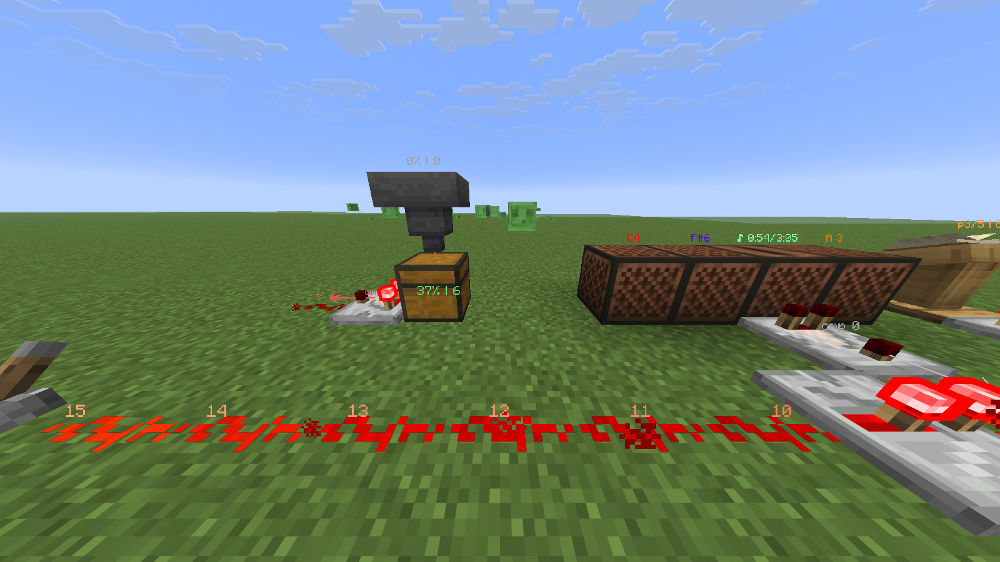

# Gauge

Client-side redstone and container diagnostics for Minecraft 26.3 (Fabric). Power levels on dust,
output arrows on repeaters, comparators, observers and hoppers, strong/weak powered blocks, pulse and
clock highlighting, container fill and comparator output, note block pitch and jukebox song progress —
drawn in the world. No server mod, no
packets of its own.



## Use

- **Z** — switch Radius mode (everything nearby) / Focus mode (crosshair only)
- **N** — hide/show the overlay
- `/gauge` — settings (also via Mod Menu), saved in `config/gauge/config.json`; `/gauge forget` — clear remembered containers
- Open a container once to read it: Gauge remembers its fill and comparator output (`37% | 6`).
  Servers never send contents of unopened containers, so those show `?`.
- Comparator outputs are estimated (`~6`): the server does not send them.
- Note blocks show their note (`C4`); the panel adds step, pitch, Hz and the next click.
- Jukeboxes show the song and its progress, if it started while you were nearby.
- Lecterns show page and comparator output (`p3/5 | 8`) once you have read the book.
- Mechanisms: doors, trapdoors and gates (open/closed, `P` when powered), pistons (`ext`/`ret`;
  `ret!`/`ext!` when power and arm disagree: BUD, quasi-connectivity, blocked push), powered and
  activator rails, detector rails with the cart's comparator value, bells (ringing/powered),
  tripwires (tripped string outlined red), unstable TNT, beehive honey level.
- Furnaces, smokers and blast furnaces show `lit`; `lit!` means lit with no fuel burning.
- Entities: chest/hopper minecarts and chest boats (fill, once opened), hopper cart lock, furnace cart
  fuel, lit TNT and TNT carts with the fuse in seconds.
- In singleplayer every value is exact and live (read from the built-in server): containers and carts
  without opening them, comparator outputs, jukebox songs, lectern pages, bees in a hive, furnace and
  furnace cart fuel, hopper cart lock.

See [SPEC.md](SPEC.md) for details and known limits.

## Build

Needs JDK 25.

```
./gradlew build          # jar in build/libs, runs the JUnit tests
./gradlew runClient
```

### Scripted in-game check

```
./gradlew runServer --args=nogui         # run-server/: flat, offline, RCON password gaugetest
./gradlew runClient "-Pdevshots=3,-60,3;6,-60,3;8,-60,3" --args="--username GaugeTester --quickPlayMultiplayer localhost:25565"
python tools/rcon.py gaugetest --script tools/testrig.txt   # once the player has joined
python tools/rcon.py gaugetest --script tools/disc.txt      # a few seconds later: starts a jukebox song
```

The client takes screenshots (`run/screenshots/gauge-*.png`), opens the test chest, aims at each
further target in focus mode, and quits. A target written as `r6,-60,8` is a radius-mode overview
instead. `tools/mechanisms.txt` builds the mechanisms, furnace, beehive and cart rows.

## License

MIT
